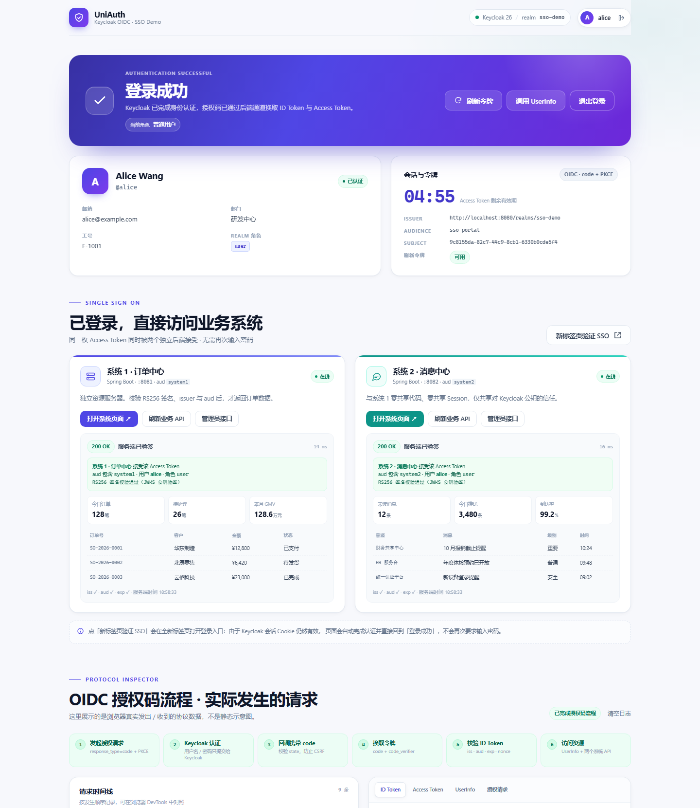
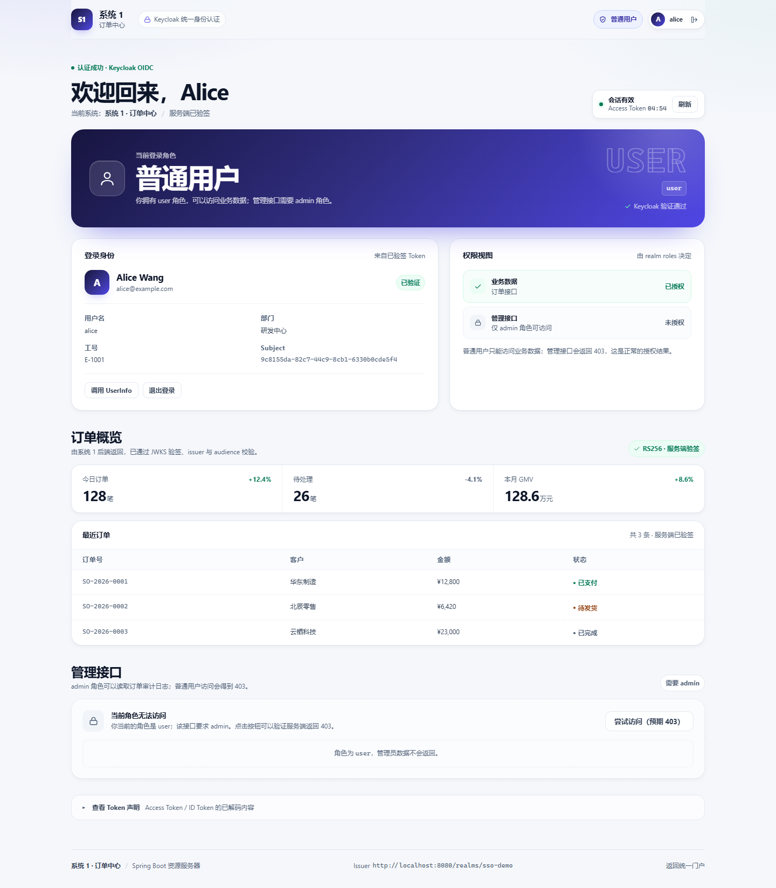
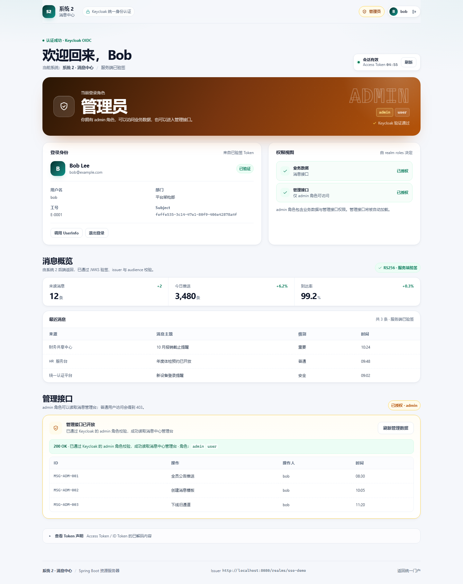
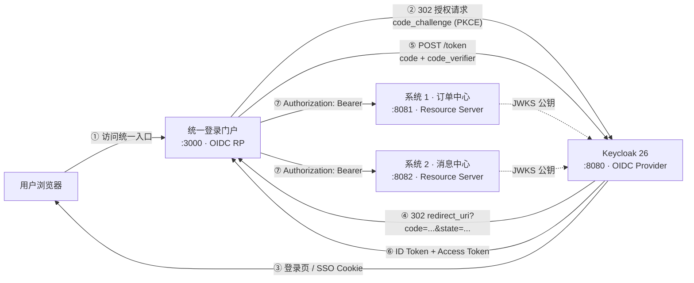

# UniAuth · Keycloak OIDC 统一身份认证 Demo

一套可直接跑通的 **OIDC 单点登录（SSO）** 演示工程：

- **Keycloak 26** 作为统一认证中心（Docker 部署，realm 自动导入）
- **两个彼此独立的 Spring Boot 3 系统**：系统 1（订单中心，:8081）、系统 2（消息中心，:8082），都作为 OAuth2 Resource Server 校验 JWT
- **一个纯前端统一登录门户**（:3000），用原生 JavaScript 实现 OIDC **Authorization Code + PKCE**，不依赖任何前端框架或 OIDC SDK
- **系统 1 / 系统 2 各自带一个可访问的前端工作台**（:8081 / :8082）：未登录时展示系统登录页，登录后以角色卡、顶栏角色徽标、权限矩阵三处同时显示当前角色（普通用户 / 管理员）
- 页面上围绕真实请求展示 **授权请求、授权码回调、Token 交换、ID Token 校验、UserInfo、Bearer 调用两个系统** 的完整过程

> 这个 Demo 的重点不是“把登录做出来”，而是把 **OIDC 协议本身** 展示清楚：浏览器地址栏里只有 `code`，Token 怎样拿到、ID Token 里有什么、后端怎样独立验签、`aud` 和角色怎样决定访问权限。



<p align="center"><sub>统一登录成功页：身份信息、两个系统的访问结果、实时 OIDC 协议检查器</sub></p>

系统页面会把“当前角色”放在首屏最醒目的位置：

<p align="center">
  
  
</p>

<p align="center"><sub>左：系统 1 以 alice 登录，角色为普通用户；右：系统 2 以 bob 登录，角色为管理员</sub></p>

---

## 1. 架构



关键边界：

| 组件 | 角色 | 是否接触用户密码 | 信任来源 |
| --- | --- | --- | --- |
| 统一登录门户 `frontend/` | OIDC Relying Party（公开客户端） | 否 | Keycloak 的 ID Token 声明 |
| Keycloak `:8080` | OpenID Provider / 认证中心 | 是（只在这里输入） | 自己的用户库 |
| 系统 1 `:8081` | OAuth2 Resource Server | 否 | Keycloak JWKS 公钥 + JWT 声明 |
| 系统 2 `:8082` | OAuth2 Resource Server | 否 | Keycloak JWKS 公钥 + JWT 声明 |

两个系统之间 **没有共享 Session、没有共享代码、没有网关**，它们唯一共享的是“Keycloak 签发的 JWT 可以被 JWKS 公钥验证”这一信任关系。

除了统一门户，**系统 1 / 系统 2 也各自托管一个前端页面**：

- 打开 <http://localhost:8081/> 或 <http://localhost:8082/>，会看到对应系统自己的登录页/工作台
- 系统页面同样通过 Keycloak 的 OIDC 授权码流程登录；如果门户已经登录过，会复用 Keycloak SSO 会话，不再要求输入密码
- Demo 为了简化，三个前端共用 `sso-portal` 这个公开客户端，但每个前端使用自己的 redirect URI；生产环境建议每个应用独立注册客户端

---

## 2. 快速开始

### 2.1 前置条件

| 依赖 | 版本 | 用途 |
| --- | --- | --- |
| Docker Desktop / Docker Engine | 24+ | 启动 Keycloak |
| JDK | **21** | 两个 Spring Boot 系统 |
| Maven | 3.9+ | 构建 / 运行系统 |
| Node.js | 18+ | 托管前端静态页、可选的冒烟测试 |

> 本项目在 `pom.xml` 中设置 `java.version=21`。Spring Boot 3.4 最低要求 Java 17，但建议按本项目使用 JDK 21。若本机默认 `java` 是 25 或其他版本，请显式设置 `JAVA_HOME` 指向 JDK 21 后再运行 Maven。

### 2.2 启动 Keycloak（Docker）

在项目根目录执行：

```bash
docker compose up -d
docker compose logs -f keycloak
```

看到类似下面的日志即可：

```text
Keycloak 26.0.8 on JVM (powered by Quarkus 3.15.1) started in ... 
Listening on: http://0.0.0.0:8080
Realm 'sso-demo' imported
```

验证：

- Discovery 文档：<http://localhost:8080/realms/sso-demo/.well-known/openid-configuration>
- 管理控制台：<http://localhost:8080/admin/>，账号 `admin / admin`
- 演示用户 `alice / alice123`（普通用户）、`bob / bob123`（管理员）已经由 realm 文件导入

> 首次启动会自动导入 `keycloak/realm-export.json`。如果修改了 realm 文件，需要 `docker compose down` 后重新 `up`（开发模式 H2 数据在容器内）。

<details>
<summary>等价的 docker run 命令</summary>

```bash
docker run -d --name sso-keycloak -p 8080:8080 \
  -e KC_BOOTSTRAP_ADMIN_USERNAME=admin \
  -e KC_BOOTSTRAP_ADMIN_PASSWORD=admin \
  -e KC_HOSTNAME=http://localhost:8080 \
  -v "$PWD/keycloak/realm-export.json:/opt/keycloak/data/import/realm-export.json:ro" \
  quay.io/keycloak/keycloak:26.0.8 \
  start-dev --import-realm
```

Windows PowerShell 中把 `$PWD` 换成 `${PWD}` 或绝对路径。
</details>

### 2.3 启动系统 1 和系统 2

开两个终端，在项目根目录分别执行：

```bash
mvn -f system1/pom.xml spring-boot:run
mvn -f system2/pom.xml spring-boot:run
```

看到 `Started System1Application in ...` / `Started System2Application in ...` 即可。健康检查：

- <http://localhost:8081/actuator/health>
- <http://localhost:8082/actuator/health>

也可以先打包，再用 `java -jar` 运行：

```bash
mvn -f system1/pom.xml -DskipTests package
mvn -f system2/pom.xml -DskipTests package
java -jar system1/target/system1-1.0.0.jar
java -jar system2/target/system2-1.0.0.jar
```

### 2.4 启动统一登录门户

```bash
node scripts/serve-frontend.mjs
```

打开：

- 统一登录门户：<http://localhost:3000>
- 系统 1 页面：<http://localhost:8081>
- 系统 2 页面：<http://localhost:8082>

> 必须使用 `localhost`，**不要用 `127.0.0.1`**：Keycloak 客户端里注册的 redirect URI 都是 `localhost`，两者在 OIDC 里是不同的字符串。

---

## 3. 演示步骤

### 3.1 第一次登录：观察授权码 + PKCE

1. 打开 <http://localhost:3000>，点击 **“使用 Keycloak 统一登录”**。
2. 页面跳转到 Keycloak 的登录页，输入 `alice / alice123`。
3. 回到门户后可以看到：
   - 巨大的 **【登录成功】** 横幅，以及 **“当前角色：普通用户”** 徽标
   - 用户姓名、邮箱、部门、工号、`realm_access.roles`
   - Access Token 有效期倒计时
   - 两个系统已自动用 **同一枚 Access Token** 调用成功
4. 在 **Protocol Inspector** 区域查看：
   - 授权请求 URL、`state`、`nonce`、`code_challenge`、`code_challenge_method=S256`
   - 浏览器收到的 `code` 与 `state`
   - `POST /token` 的 `grant_type=authorization_code`、`code_verifier`
   - 解码后的 **ID Token** 与 **Access Token**
   - 每一步的请求 / 响应详情

### 3.2 直接打开系统页面：角色一眼可见

1. 打开 <http://localhost:8081> 或 <http://localhost:8082>。
2. 未登录时会看到系统自己的登录页：介绍该系统、说明密码只提交给 Keycloak，并提示登录后会显示角色。
3. 点击 **“使用 Keycloak 统一登录”**：
   - 如果此前已经在门户登录过，Keycloak 会复用 SSO 会话，**直接免密回到系统页面**
   - 否则进入 Keycloak 登录页
4. 登录后，当前角色会在三个位置同时出现：
   - 顶栏的角色徽标（普通用户 / 管理员）
   - 首屏的大字角色卡（例如“普通用户 / USER”）
   - 权限矩阵（业务数据 已授权、管理接口 未授权/已授权）
5. 用 `alice` 和 `bob` 分别登录同一个系统，可以直观看到角色卡从蓝色“普通用户”切换为金色“管理员”，管理接口从 403 变为 200。

系统 1 和系统 2 使用相同的页面结构、不同主题色（系统 1 靛蓝、系统 2 青绿），方便对照“同一套 OIDC、两个独立系统”。

### 3.3 验证 SSO 免密

方式一：在门户点击系统区域右上角的 **“新标签页验证 SSO”**。

方式二：在已经登录系统 1 的情况下，直接打开 <http://localhost:8082> 并点击登录。

两种方式下，新页面都没有门户/另一个系统的 `sessionStorage`，但浏览器仍然带着 Keycloak 的 SSO 会话 Cookie，因此授权请求会被 Keycloak 直接放行，**不再出现登录页**。

### 3.4 验证“认证 ≠ 授权”

在系统页面里，用 `alice`（只有 `user` 角色）点击 **“尝试访问（预期 403）”**：

- 系统 1 / 系统 2 都返回 **403**
- 页面展示后端返回的 `requiredRole: admin` 和 `yourRoles: ["user"]`

退出登录，改用 `bob / bob123`（`user` + `admin`）登录，再访问管理员接口：

- 管理接口的卡片变成金色“已授权”，并自动加载审计 / 管理记录

### 3.5 退出登录

点击右上角或系统页面里的 **“退出登录”**：

- 前端清除本地 Token
- 跳转 Keycloak 的 `end_session_endpoint`（RP-Initiated Logout）
- 带 `id_token_hint` 结束 Keycloak SSO 会话
- 回到当前系统的登录页（如果从门户退出则回门户），再次登录会重新出现登录页

### 3.6 协议演示账号

| 用户名 | 密码 | realm 角色 | 说明 |
| --- | --- | --- | --- |
| `alice` | `alice123` | `user` | 可访问两个系统的业务接口，管理员接口 403 |
| `bob` | `bob123` | `user`, `admin` | 额外可访问两个系统的管理员接口 |

---

## 4. 端口与 API

| 地址 | 说明 |
| --- | --- |
| <http://localhost:3000> | 统一登录门户（静态前端） |
| <http://localhost:8080> | Keycloak |
| <http://localhost:8081> | 系统 1 页面 + 订单中心 API |
| <http://localhost:8082> | 系统 2 页面 + 消息中心 API |

### 系统接口

| 方法 | 路径 | 权限 |
| --- | --- | --- |
| GET | `/api/public/info` | 公开 |
| GET | `/api/system1/dashboard` | 已认证，且具备 `user` 或 `admin` |
| GET | `/api/system1/admin/audit` | 已认证，且具备 `admin` |
| GET | `/api/system2/dashboard` | 已认证，且具备 `user` 或 `admin` |
| GET | `/api/system2/admin/console` | 已认证，且具备 `admin` |

所有受保护接口都要求：

```http
Authorization: Bearer <access_token>
```

`aud` 必须分别包含 `system1` / `system2`（由 Keycloak 的 audience mapper 注入）。

---

## 5. OIDC 实现要点

### 5.1 Keycloak 端

- `keycloak/realm-export.json` 定义 realm、客户端、角色、用户、协议映射器
- `sso-portal`：公开客户端，只用 **Standard Flow**（授权码），开启 **PKCE S256**。为了 Demo 简洁，统一门户与两个系统页面共用它，但注册了三个 redirect URI：`3000/`、`8081/`、`8082/`
- `system1` / `system2`：不参与浏览器登录，仅作为 **audience** 注册
- `sso-portal` 上配置了 4 个 Protocol Mapper：
  - `aud-system1`：向 Access Token 注入 `aud: system1`
  - `aud-system2`：向 Access Token 注入 `aud: system2`
  - `department`、`employeeNo`：将用户属性写入 ID Token / Access Token / UserInfo

详见 **[docs/keycloak-setup.md](docs/keycloak-setup.md)**。

### 5.2 前端（OIDC RP）

核心文件：

- [`frontend/js/oidc.js`](frontend/js/oidc.js)：完整 OIDC 客户端
  - `discover()`：读取 `.well-known/openid-configuration`
  - `login()`：生成 `state` / `nonce` / `code_verifier`，计算 S256 `code_challenge`，跳转授权端点
  - `handleCallback()`：校验 `state`，用 `code + code_verifier` 换 Token，校验 `iss / aud / azp / exp / nonce`
  - `ensureToken() / refresh()`：Token 临近过期时用 `refresh_token` 静默刷新
  - `fetchUserInfo()`：Bearer 调用 UserInfo
  - `logout()`：RP-Initiated Logout
- [`frontend/js/app.js`](frontend/js/app.js)：页面状态、协议时间线、Token 展示、两个系统的 API 调用
- [`frontend/config.js`](frontend/config.js)：issuer、client_id、redirect_uri、两个系统的地址

系统页面复用同一个 OIDC 客户端代码，但有自己的配置和存储前缀：

- [`system1/.../static/index.html`](system1/src/main/resources/static/index.html)、[`system1/.../static/assets/app.js`](system1/src/main/resources/static/assets/app.js)
- [`system2/.../static/index.html`](system2/src/main/resources/static/index.html)、[`system2/.../static/assets/app.js`](system2/src/main/resources/static/assets/app.js)
- 每个系统独立的 [`config.js`](system1/src/main/resources/static/config.js)：systemId、主题色、API 路径、storagePrefix
- 登录后从 **Access Token 的 `realm_access.roles`** 读取角色，同时用后端返回的 `user.roles` 交叉确认；角色会出现在顶栏、角色卡和权限视图中

> 这是一份“教学型”实现：没有使用 oidc-client-ts 等库，以便把每一步真实请求展示在页面上。浏览器端只做 Token 的 **声明校验**；JWT 的 **签名验证** 由两个资源服务器通过 JWKS 完成。

### 5.3 后端（Resource Server）

系统 1 和系统 2 的配置几乎对称：

```yaml
spring:
  security:
    oauth2:
      resourceserver:
        jwt:
          issuer-uri: http://localhost:8080/realms/sso-demo
          audiences: system1   # 系统 2 为 system2
```

Spring Security 在进入 Controller 之前自动完成：

- 从 `Authorization: Bearer` 中提取 JWT
- 通过 `issuer-uri` 拉取 JWKS 并验证 **RS256 签名**
- 校验 `iss`、`exp`、`nbf`
- 校验 `aud` 是否包含配置的 audience
- 把 Keycloak 的 `realm_access.roles` 映射为 `ROLE_user` / `ROLE_admin`

关键类：

- [`system1/.../SecurityConfig.java`](system1/src/main/java/com/example/sso/system1/config/SecurityConfig.java)
- [`system1/.../System1Controller.java`](system1/src/main/java/com/example/sso/system1/web/System1Controller.java)
- [`system2/.../SecurityConfig.java`](system2/src/main/java/com/example/sso/system2/config/SecurityConfig.java)
- [`system2/.../System2Controller.java`](system2/src/main/java/com/example/sso/system2/web/System2Controller.java)

两个系统都：

- 无状态：`SessionCreationPolicy.STATELESS`，不创建 HttpSession
- 后端不处理登录，只接受 Bearer Token；系统页面本身是公开静态资源，登录由浏览器里的 OIDC 流程完成
- `SecurityConfig` 只放行 `/`、`/index.html`、`/config.js`、`/assets/**`、`/error` 和 `/api/public/**`，其他 API 仍需 Token
- 对 401 / 403 返回统一 JSON，便于前端展示原因
- 允许门户 `http://localhost:3000` 跨域调用 API，并正确响应带 `Authorization` 的预检请求；系统页面与 API 同源，不需要 CORS

### 5.4 协议文档

- **[docs/architecture.md](docs/architecture.md)**：组件、信任边界、时序图、Token 声明表
- **[docs/keycloak-setup.md](docs/keycloak-setup.md)**：Docker、realm 导入、客户端 / 角色 / 用户配置
- **[docs/oidc-flow.md](docs/oidc-flow.md)**：逐步协议报文、PKCE、ID Token 校验、资源访问、登出、错误排查

---

## 6. 端到端验证

项目自带一个不依赖浏览器的冒烟测试，会真实提交 Keycloak 登录表单、走完授权码流程。运行前请确保第 2 节中的 Keycloak、两个系统、前端服务都已启动：

```bash
node scripts/smoke-test.mjs
```

覆盖 15 项检查（实际运行输出）：

```text
✓ OIDC Discovery：issuer 与端点
✓ 授权码 + PKCE：alice 登录并换取令牌
✓ ID Token 身份声明：姓名 / 邮箱 / 部门 / 角色 / nonce
✓ UserInfo：使用 Bearer Access Token 获取用户信息
✓ 系统 1：带 Bearer Token 访问业务接口
✓ 系统 2：同一枚 Access Token 也被接受
✓ 系统 1：alice 访问 admin 接口应返回 403
✓ 系统 2：alice 访问 admin 接口应返回 403
✓ 资源服务器：不带 Token 访问应返回 401 JSON
✓ CORS 预检：系统 1 允许门户携带 Authorization
✓ refresh_token：静默刷新并再次访问系统 1
✓ SSO：同一 Keycloak 会话再次授权，无需登录页直接回调 code
✓ 管理员 bob：登录并访问两个系统的 admin 接口
✓ RP-Initiated Logout：结束 Keycloak 会话并回到门户
✓ 登出后：新的授权请求必须重新显示登录页

结果：15 通过，0 失败
```

浏览器端另外验证了：

- 统一门户：登录成功、角色徽标、两个系统自动调用、打开系统页面链接
- 系统 1：alice 登录后角色卡为“普通用户”，管理接口 403；bob 登录后角色卡为“管理员”，管理数据自动加载
- 系统 2：在系统 1 已登录的情况下直接打开并点击登录，Keycloak SSO 免密进入；角色卡为“管理员”
- 三个页面均无控制台错误，退出登录后重新要求认证

本机验证环境：Keycloak 26.0.8（`start-dev` + realm import）、Spring Boot 3.4.13 / JDK 21、Chrome Headless。Docker Compose 使用相同的 Keycloak 镜像与启动参数。

---

## 7. 项目结构

```text
keycloak-oidc-sso-demo/
├── docker-compose.yml                 # Keycloak 26 + realm 自动导入
├── keycloak/
│   └── realm-export.json              # realm、客户端、角色、用户、mapper
├── system1/                           # 系统 1 · 订单中心（Spring Boot 3）
│   ├── pom.xml
│   └── src/main/
│       ├── java/com/example/sso/system1/
│       │   ├── config/SecurityConfig.java
│       │   └── web/…                  # Controller / 401 / 403 / DTO
│       └── resources/static/          # 系统 1 前端：登录页 + 角色工作台
│           ├── index.html
│           ├── config.js              # 系统 1 主题 / API / client_id
│           └── assets/{app.css,app.js,oidc.js}
├── system2/                           # 系统 2 · 消息中心（结构对称，青绿主题）
├── frontend/
│   ├── index.html                     # 统一登录 + 认证结果 + 协议检查器
│   ├── config.js                      # OIDC 参数与系统地址
│   ├── css/app.css
│   └── js/{oidc.js, app.js}
├── scripts/
│   ├── serve-frontend.mjs             # 零依赖静态服务器（:3000）
│   └── smoke-test.mjs                 # 端到端 OIDC 冒烟测试
└── docs/
    ├── architecture.md
    ├── keycloak-setup.md
    ├── oidc-flow.md
    └── screenshots/
        ├── keycloak-login.png
        ├── success.png
        ├── system1-landing.png
        ├── system1-user.png
        └── system2-admin.png
```

---

## 8. 常见问题

### 登录后报 `invalid_redirect_uri`

使用了 `127.0.0.1` 或改了端口。OIDC 的 `redirect_uri` 是精确字符串匹配，必须和 `keycloak/realm-export.json` 中 `sso-portal` 的 `redirectUris` 完全一致。当前注册了：

```text
http://localhost:3000/
http://localhost:8081/
http://localhost:8082/
```

改端口时需要同时更新三个前端配置和 Keycloak 客户端。

### 页面提示“无法连接 Keycloak”

- `docker compose ps` 确认容器在运行
- 直接访问 <http://localhost:8080/realms/sso-demo/.well-known/openid-configuration>
- 若 8080 被占用，改 compose 端口后同步修改：`frontend/config.js` 的 issuer、两个系统的 `SSO_ISSUER`、Keycloak 的 `KC_HOSTNAME`

### 直接打开 8081 / 8082 为什么以前是 401，现在是什么？

以前 8081 / 8082 只作为 API，`/` 也被 Spring Security 的 `anyRequest().authenticated()` 保护，浏览器地址栏不会携带 Bearer Token，所以返回 JSON 401。

现在两个系统都自带了前端页面，`SecurityConfig` 放行了 `/`、`/assets/**` 等静态资源：

- 打开 <http://localhost:8081/> / <http://localhost:8082/> 会看到系统页面
- 未登录时页面显示“使用 Keycloak 统一登录”
- 直接访问 `/api/system1/dashboard` 等 API 且不带 Bearer Token，仍然会返回 **401**，这是资源服务器的正确行为

### 前端调用系统接口出现 CORS 错误

- 统一门户必须从 `http://localhost:3000` 打开；系统页面与自己的 API 同源，不需要 CORS
- 两个系统的 `app.frontend-origin` 默认是门户地址；改门户端口时同步修改
- 401 响应也带 CORS 头，本项目的自定义 `AuthenticationEntryPoint` 由 Spring 的 CORS Filter 处理

### 系统页面登录后返回 401 / 403

- 401：Token 过期、issuer 不一致或 aud 不含当前系统
- 403：Token 有效，但当前角色没有 `admin`；这是预期的授权结果
- 系统页面会同时显示角色卡和权限视图，先看页面上的角色是否与预期一致

### 系统返回 401，但 Token 看起来正常

检查后端日志 / 响应里的 `WWW-Authenticate`：

- `iss` 不一致：Keycloak 的 `KC_HOSTNAME` 与后端 `issuer-uri` 必须相同
- `aud` 不匹配：确认 Keycloak 客户端的 audience mapper 注入了 `system1` / `system2`
- `exp` 过期：点击“刷新令牌”或用 refresh_token 重新获取

### `alice` 访问管理员接口是 403

这是预期行为：403 表示 **认证成功但授权不足**。用 `bob / bob123` 登录即可看到 200。

### 修改 realm 文件后没有生效

`start-dev` 使用容器内 H2，`docker compose down` 会删除容器及数据，之后再 `up` 会重新导入。只想改用户/客户端时也可以直接在管理控制台修改。

### `mvn` 用了 JDK 25 报错

显式指定 JDK 21：

```powershell
$env:JAVA_HOME = "C:\path\to\jdk-21"
$env:Path = "$env:JAVA_HOME\bin;$env:Path"
mvn -v
```

```bash
export JAVA_HOME=/path/to/jdk-21
export PATH="$JAVA_HOME/bin:$PATH"
mvn -v
```

---

## 9. 安全说明（重要）

这是一个**教学 / 演示项目**，默认配置为了本地跑通做了简化：

- Keycloak 使用 `start-dev` + H2，realm `sslRequired=none`，管理账号 `admin/admin`
- 三个前端（门户 + 系统 1 + 系统 2）共用同一个公开客户端 `sso-portal`，Token 存在各自 origin 的 `sessionStorage`，对页面 JavaScript 可见
- 系统页面通过公开静态资源提供，真正的 API 仍然全部要求 Bearer Token；不要把静态页面的公开误认为 API 公开
- 后端与 Keycloak 之间、浏览器与 Keycloak 之间都是 HTTP（仅限 localhost）

生产环境不建议直接套用：

1. 使用 **BFF（Backend for Frontend）** 或服务端会话，把 Token 留在服务端；纯 SPA 至少要评估 XSS 风险
2. 为门户和每个系统分别注册独立客户端，按应用最小化 redirect URI、web origin 和 API audience
3. Keycloak 使用 HTTPS、外部数据库、`start` 而非 `start-dev`，关闭默认管理员口令
4. 收紧 redirect URI / web origin，不要使用宽泛通配符
5. 缩短 Access Token 生命周期，启用 refresh token rotation、会话撤销与安全事件
6. 后端继续使用 JWKS 本地验签，并配合 `aud`、scope、角色做最小权限控制
7. 配置 CSP、`Referrer-Policy`、HSTS 等响应头

---

## 10. 参考

- [OpenID Connect Core 1.0](https://openid.net/specs/openid-connect-core-1_0.html)
- [RFC 7636 · PKCE](https://www.rfc-editor.org/rfc/rfc7636)
- [Keycloak Server Administration Guide](https://www.keycloak.org/docs/latest/server_admin/)
- [Spring Security · OAuth 2.0 Resource Server](https://docs.spring.io/spring-security/reference/servlet/oauth2/resource-server/index.html)
