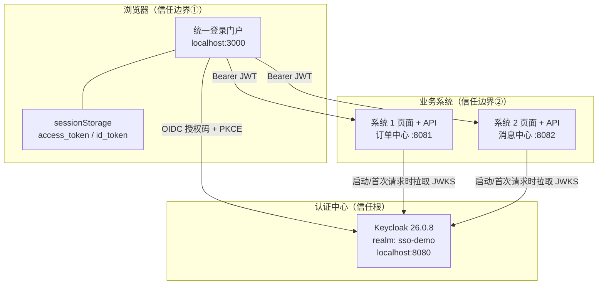
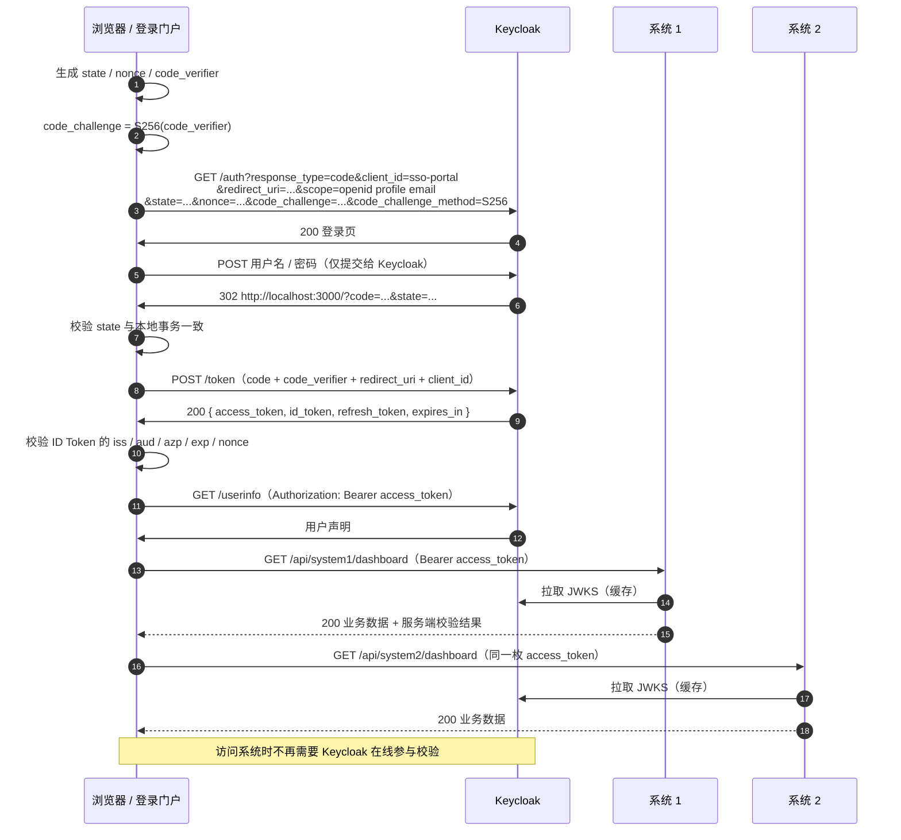

# 架构设计

## 1. 目标

这个 Demo 要回答四个问题：

1. 用户只在 **Keycloak** 输入一次密码，为什么可以访问两个彼此独立的系统？
2. 浏览器在 OIDC 授权码流程中到底拿到了什么？为什么这些数据不足以直接伪造身份？
3. 两个 Spring Boot 系统如何在**不调用 Keycloak** 的情况下校验 Token？
4. `admin` 接口为什么对同一个“已登录用户”仍然返回 403？

## 2. 组件



| 组件 | 技术 | 端口 | 职责 |
| --- | --- | --- | --- |
| Keycloak | Keycloak 26.0.8（Quarkus） | 8080 | 登录页、用户目录、签发 ID Token / Access Token、JWKS、SSO 会话、登出 |
| 统一登录门户 | 原生 HTML/CSS/JS（ES Module） | 3000 | 统一 OIDC RP：发起授权、处理回调、校验 ID Token、展示协议、调用两个系统 |
| 系统 1 前端 | Spring Boot 静态资源 + 原生 JS | 8081 | 系统 1 登录页/工作台：发起 OIDC、展示角色、调用本系统 API |
| 系统 1 后端 | Spring Boot 3.4.13 + Spring Security 6.4 | 8081 | 资源服务器：JWKS 验签、`aud=system1`、角色授权、订单业务接口 |
| 系统 2 前端 | Spring Boot 静态资源 + 原生 JS | 8082 | 系统 2 登录页/工作台：发起 OIDC、展示角色、调用本系统 API |
| 系统 2 后端 | Spring Boot 3.4.13 + Spring Security 6.4 | 8082 | 资源服务器：JWKS 验签、`aud=system2`、角色授权、消息业务接口 |

## 3. 信任边界

### 3.1 浏览器不可信

门户和两个系统页面都是 **public client**（Demo 中共用 `sso-portal`），没有 `client_secret`。因此：

- 不能把客户端密钥放在浏览器里
- 必须使用 **Authorization Code + PKCE**，不用 Implicit Flow
- ID Token 的签名由浏览器端“看”到，但真正的强校验发生在资源服务器
- 三个前端各自使用自己的 `sessionStorage`，Token 不跨 origin 共享；SSO 依赖 Keycloak 会话 Cookie，而不是复制 Token
- 关闭标签页即销毁本地 Token（演示目的，生产建议 BFF）

### 3.2 系统只信任 Keycloak 的签名

系统 1 / 2 不保存用户密码、不维护 Session、不回调 Keycloak 的 introspection 接口，而是：

1. 从 `issuer-uri` 对应的 `.well-known/openid-configuration` 获取 `jwks_uri`
2. 拉取公钥并缓存
3. 本地验证 RS256 签名、`iss`、`exp`、`nbf`
4. 校验 `aud` 包含自己
5. 把 `realm_access.roles` 映射成 `ROLE_*`

这使两个系统完全无状态、可水平扩展。

### 3.3 Keycloak 是唯一信任根

用户密码、用户属性、角色、SSO Cookie、签名私钥都只在 Keycloak 内。两个系统只持有公钥。

## 4. 登录时序



## 5. Token 设计

### 5.1 两个 Token 各司其职

| Token | 受众 `aud` | 用途 | 谁校验 |
| --- | --- | --- | --- |
| **ID Token** | `sso-portal` | 证明“用户是谁、认证何时发生” | 门户 / 系统页面（浏览器端声明校验；生产可由 BFF 验证签名） |
| **Access Token** | `system1`, `system2` | 证明“有权访问哪些资源” | 系统 1 / 2（JWKS 签名 + `aud` + 角色） |

### 5.2 ID Token 关键声明

| 声明 | 示例 | 说明 |
| --- | --- | --- |
| `iss` | `http://localhost:8080/realms/sso-demo` | 必须与配置的 issuer 完全一致 |
| `aud` | `sso-portal` | ID Token 的预期接收者 |
| `azp` | `sso-portal` | 授权方 |
| `sub` | `af3a613e-…` | 用户在本 realm 的稳定唯一标识 |
| `nonce` | `zkUxeIvj…` | 与授权请求中的 nonce 一致，防重放 |
| `exp` / `iat` | Unix 秒 | 有效期 |
| `preferred_username` | `alice` | 用户名 |
| `name` / `email` | `Alice Wang` / `alice@example.com` | profile / email scope |
| `department` | `研发中心` | 自定义用户属性（protocol mapper） |
| `employee_no` | `E-1001` | 自定义用户属性（protocol mapper） |

> 注意：Keycloak 默认**不会**把 `realm_access.roles` 放进 ID Token。本项目遵循“ID Token 负责认证、Access Token 负责授权”的划分，页面上的角色展示从 Access Token 读取。

### 5.3 Access Token 关键声明

| 声明 | 示例 | 说明 |
| --- | --- | --- |
| `aud` | `["system1", "system2"]` | 由 portal 客户端的 audience mapper 注入 |
| `realm_access.roles` | `["user"]` | 资源服务器的角色来源 |
| `scope` | `openid email profile` | 授权范围 |
| `azp` | `sso-portal` | 哪个客户端申请的 Token |
| `session_state` | UUID | 对应 Keycloak 的 SSO 会话 |
| `department` / `employee_no` | 同上 | 用户属性 |

两个系统使用**同一枚 Access Token**，因此 `aud` 同时包含 `system1` 和 `system2`。这是“单点登录后通行多个系统”的直接体现。

## 6. 单点登录（SSO）为什么成立

Keycloak 登录成功后，会在 `localhost:8080` 上写入 **SSO 会话 Cookie**（`KEYCLOAK_SESSION` / `KEYCLOAK_IDENTITY` 等）。

当用户在新标签页或另一个系统页面再次登录：

1. 新页面没有本地 Token，于是重新发起授权请求（它有自己的 redirect URI）
2. 浏览器自动带上 `localhost:8080` 的 Keycloak Cookie
3. Keycloak 发现 SSO 会话有效，**直接 302 回当前页面的 `redirect_uri?code=...`**，不渲染登录页
4. 当前系统用新 code 换新 Token，页面进入自己的“登录成功”视图

本项目的“新标签页验证 SSO”按钮打开 `http://localhost:3000/?login=1`；直接打开 <http://localhost:8081> 或 <http://localhost:8082> 并点击登录，也会走同一套 SSO。

> 浏览器对 Cookie 的隔离、`SameSite` 策略以及第三方 Cookie 限制会影响 SSO。本 Demo 中门户与 Keycloak 都是 `localhost`（同站，忽略端口），因此不受影响。

## 7. 认证 ≠ 授权

`alice` 的 Token 是**有效**的：签名、issuer、audience、有效期全部通过。但访问：

```text
GET /api/system1/admin/audit
```

时被 Spring Security 拒绝：

- `hasRole("admin")` 要求 `ROLE_admin`
- `alice` 的 `realm_access.roles` 只有 `user`
- 返回 **403 Forbidden**，响应体说明 `requiredRole` 和 `yourRoles`

这正是 OAuth2 的授权语义：**认证回答“你是谁”，授权回答“你能做什么”**。

## 8. 无状态与可扩展性

### 8.1 无状态

两个系统：

```java
.sessionManagement(s -> s.sessionCreationPolicy(SessionCreationPolicy.STATELESS))
```

没有 HttpSession、没有登录页、没有 CSRF Token。每个请求都携带 Bearer Token，权限完全由 JWT 声明决定。

### 8.2 增加第三个系统

1. Keycloak 新建 client `system3`（禁用 Standard Flow）
2. 在 `sso-portal` 上增加 audience mapper：`system3`
3. 复制 system1 工程，修改：
   - 端口
   - `spring.security.oauth2.resourceserver.jwt.audiences: system3`
   - 业务接口
4. 给 `sso-portal` 注册 system3 页面的 redirect URI / web origin，或给系统 3 建独立客户端
5. 复制系统页面静态资源，修改 `config.js` 的 systemId、主题、API 路径和 redirect URI
6. 系统 3 根据自己的角色规则做授权

不需要修改 Keycloak 的登录流程，也不需要让系统 3 与系统 1 / 2 共享任何代码。

### 8.3 关于把系统放进 Docker

本 Demo 默认让两个系统在宿主机运行，Keycloak 在 Docker 中，issuer 统一为 `http://localhost:8080/realms/sso-demo`。

如果要把系统也放进 Docker，注意：

- 容器内的 `localhost:8080` 指向容器自己，必须使用 `http://keycloak:8080` 或 `host.docker.internal:8080` 访问 Keycloak
- 但 **JWT 的 `iss` 仍然是 `http://localhost:8080/...`**（浏览器看到的地址）
- 因此后端不能只配置 `issuer-uri`，需要同时配置：
  - `issuer-uri: http://localhost:8080/realms/sso-demo`（用于校验 iss）
  - `jwk-set-uri: http://keycloak:8080/realms/sso-demo/protocol/openid-connect/certs`（用于容器内取公钥）

本 Demo 的主路径不涉及这个网络差异。

## 9. 前端协议检查器的设计

`frontend/js/oidc.js` 的每个关键动作都会发出结构化事件：

```js
{
  category: 'authorize' | 'callback' | 'token' | 'validate' | 'userinfo' | 'api' | 'refresh' | 'logout' | 'error',
  title, method, url, status, durationMs,
  request, response, checks, note
}
```

`frontend/js/app.js` 把这些事件：

- 写入 `sessionStorage`（跳转到 Keycloak 再回来也能看到完整时间线）
- 渲染为“请求时间线”
- 驱动 6 步授权码流程的完成状态
- 把 ID Token / Access Token / UserInfo 展示到不同 Tab

因此页面上的协议数据是**真实发生过的请求与响应**，不是静态示意图。

## 10. 已知取舍

| 取舍 | 选择 | 原因 |
| --- | --- | --- |
| 前端是否使用 OIDC SDK | 不使用，手写 | 教学目的：每一步显式可见 |
| Token 存储 | `sessionStorage` | Demo 简单；生产建议 BFF / 内存 + 短生命周期 |
| 客户端类型 | Public + PKCE | 纯前端无法安全保存 secret |
| 三个前端共用客户端 | Demo 共用 `sso-portal` | 简化配置；生产按应用拆分客户端，收紧 redirect URI / audience |
| 资源服务器校验方式 | 本地 JWKS | 无状态、低延迟；JWKS 缓存后 Keycloak 短暂不可用不影响已签发 Token |
| 用户数据 | Keycloak 内 H2 | Demo 零外部依赖；生产用 PostgreSQL |
| 授权粒度 | realm roles | 演示简单；生产可用 client roles / scopes / policies |
| 登出 | RP-Initiated Logout | 同时清理本地 Token 和 Keycloak SSO 会话 |

更多细节：

- [Keycloak 配置](keycloak-setup.md)
- [OIDC 协议逐步说明](oidc-flow.md)
