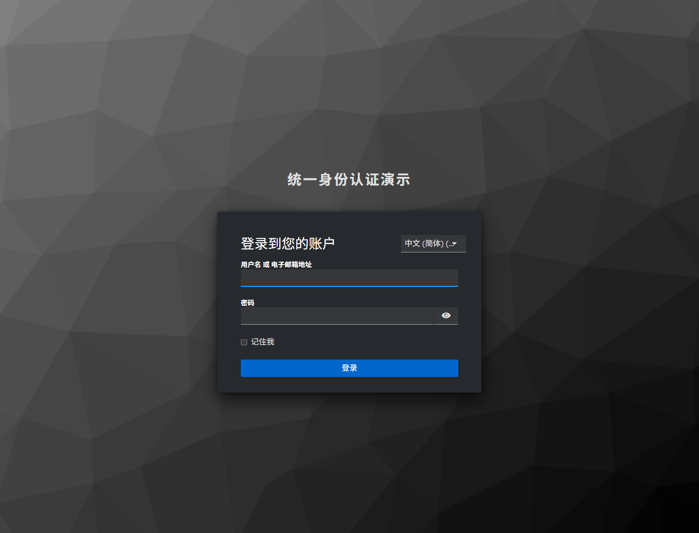

# Keycloak 配置说明



<p align="center"><sub>realm 导入后 Keycloak 自带的中文登录页</sub></p>

本文覆盖三种场景：

1. 直接用 `docker compose` 启动并**自动导入** realm（推荐）
2. 导入现成的 `realm-export.json` 到已有 Keycloak
3. 不导入文件，在管理控制台**手工创建**所有配置

---

## 1. 用 Docker 启动并自动导入

### 1.1 docker compose（推荐）

`docker-compose.yml` 已经写好：

```yaml
services:
  keycloak:
    image: quay.io/keycloak/keycloak:26.0.8
    container_name: sso-keycloak
    command:
      - start-dev
      - --import-realm
      - --http-port=8080
    environment:
      KC_BOOTSTRAP_ADMIN_USERNAME: admin
      KC_BOOTSTRAP_ADMIN_PASSWORD: admin
      KC_HOSTNAME: http://localhost:8080
      KC_HTTP_ENABLED: "true"
      KC_LOG_LEVEL: INFO
    ports:
      - "8080:8080"
    volumes:
      - ./keycloak/realm-export.json:/opt/keycloak/data/import/realm-export.json:ro
```

启动：

```bash
docker compose up -d
docker compose logs -f keycloak
```

关键日志：

```text
Importing from directory /opt/keycloak/data/import
Realm 'sso-demo' imported
Import finished successfully
Keycloak 26.0.8 on JVM ... started in 10.273s. Listening on: http://0.0.0.0:8080
```

### 1.2 docker run 等价命令

```bash
docker run -d --name sso-keycloak -p 8080:8080 \
  -e KC_BOOTSTRAP_ADMIN_USERNAME=admin \
  -e KC_BOOTSTRAP_ADMIN_PASSWORD=admin \
  -e KC_HOSTNAME=http://localhost:8080 \
  -v "$PWD/keycloak/realm-export.json:/opt/keycloak/data/import/realm-export.json:ro" \
  quay.io/keycloak/keycloak:26.0.8 \
  start-dev --import-realm
```

Windows PowerShell：

```powershell
docker run -d --name sso-keycloak -p 8080:8080 `
  -e KC_BOOTSTRAP_ADMIN_USERNAME=admin `
  -e KC_BOOTSTRAP_ADMIN_PASSWORD=admin `
  -e KC_HOSTNAME=http://localhost:8080 `
  -v "${PWD}\keycloak\realm-export.json:/opt/keycloak/data/import/realm-export.json:ro" `
  quay.io/keycloak/keycloak:26.0.8 start-dev --import-realm
```

### 1.3 为什么固定 `KC_HOSTNAME`

OIDC 的 `iss` 是**精确字符串**。后端的 `spring.security.oauth2.resourceserver.jwt.issuer-uri` 必须与 Token 里的 `iss` 完全一致。

固定：

```text
http://localhost:8080/realms/sso-demo
```

可以保证：

- 浏览器访问 Keycloak 使用 `localhost:8080`
- Keycloak 签发的 `iss` 是 `http://localhost:8080/realms/sso-demo`
- 两个后端用同一个 `issuer-uri` 校验成功
- 即使请求的 Host 头不同，issuer 也不会漂移

如果改成其他端口 / 域名，需要同步修改：

- `KC_HOSTNAME`
- `docker-compose.yml` 的端口映射
- `frontend/config.js` 的 `issuer`
- 两个系统的 `SSO_ISSUER`（默认在 `application.yml`）
- Keycloak 客户端 `sso-portal` 的 redirect URI / web origin
- 两个系统的 `app.frontend-origin`

### 1.4 进入管理控制台

- 地址：<http://localhost:8080/admin/>
- 账号：`admin` / `admin`（来自 `KC_BOOTSTRAP_ADMIN_*`）
- 左上角 realm 选择器切到 **sso-demo**

> 控制台的 admin 是 **master realm** 的管理员；演示用户 `alice` / `bob` 在 `sso-demo` realm 中，二者不是同一个用户体系。

---

## 2. realm 自动导入的内容

`keycloak/realm-export.json` 已经包含：

### 2.1 Realm

| 配置 | 值 |
| --- | --- |
| realm | `sso-demo` |
| 显示名 | 统一身份认证演示 |
| 语言 | `zh-CN` / `en`，默认 `zh-CN` |
| SSL | `none`（仅本地演示） |
| Access Token 有效期 | 300 秒 |
| SSO Session Idle / Max | 30 分钟 / 8 小时 |
| 事件日志 | 开启（登录事件可在控制台查看） |

### 2.2 客户端

| Client ID | 类型 | 用途 | 关键配置 |
| --- | --- | --- | --- |
| `sso-portal` | Public | 统一门户 + 系统 1 / 系统 2 页面共用的 OIDC RP | Standard Flow、PKCE S256、3 个 redirect URIs |
| `system1` | Confidential | 系统 1 的 audience 标识 | Standard Flow 关闭，不参与浏览器登录 |
| `system2` | Confidential | 系统 2 的 audience 标识 | Standard Flow 关闭 |

> Demo 为了简化，三个前端共用 `sso-portal` 这一个公开客户端；每个前端使用自己的 redirect URI。生产环境建议每个应用独立注册客户端。

`sso-portal` 的关键配置：

```text
Valid redirect URIs:
  http://localhost:3000/
  http://localhost:3000/index.html
  http://localhost:8081/
  http://localhost:8081/index.html
  http://localhost:8082/
  http://localhost:8082/index.html
Web origins:
  http://localhost:3000
  http://localhost:8081
  http://localhost:8082
Valid post logout redirect URIs:
  http://localhost:3000/
  http://localhost:8081/
  http://localhost:8082/
Proof Key for Code Exchange Code Challenge Method:
  S256
```

> `system1` / `system2` 的 secret 只是 Keycloak 客户端模型的一部分；两个 Spring Boot 资源服务器**不会使用**它。资源服务器通过公钥验签，不需要 client secret。

### 2.3 角色

| Realm Role | 说明 |
| --- | --- |
| `user` | 普通业务用户，可访问系统 1 / 2 的业务接口 |
| `admin` | 管理员，额外可访问系统 1 / 2 的管理接口 |

### 2.4 用户

| 用户 | 密码 | 角色 | 属性 |
| --- | --- | --- | --- |
| `alice` | `alice123` | `user` | department=研发中心, employeeNo=E-1001 |
| `bob` | `bob123` | `user`, `admin` | department=平台架构部, employeeNo=E-0001 |

### 2.5 Protocol Mappers（配置在 sso-portal 上）

| Mapper | 类型 | 作用 |
| --- | --- | --- |
| `aud-system1` | Audience | Access Token 的 `aud` 加入 `system1` |
| `aud-system2` | Audience | Access Token 的 `aud` 加入 `system2` |
| `department` | User Attribute | 把 `department` 写入 ID Token / Access Token / UserInfo |
| `employeeNo` | User Attribute | 把 `employee_no` 写入 ID Token / Access Token / UserInfo |

`aud-system1` 的典型配置：

```text
Included Custom Audience: system1
Add to ID token: OFF
Add to access token: ON
```

---

## 3. 把 realm 导入到已有 Keycloak

如果 Keycloak 已经启动、但 realm 不存在：

### 方式 A：控制台导入

1. 打开 <http://localhost:8080/admin/>
2. 左上角 realm 下拉 → **Create realm**
3. Resource file → **Browse** → 选择 `keycloak/realm-export.json`
4. **Create**

### 方式 B：kcadm.sh

```bash
docker exec -i sso-keycloak /opt/keycloak/bin/kcadm.sh \
  config credentials \
  --server http://localhost:8080 \
  --realm master \
  --user admin \
  --password admin

docker exec -i sso-keycloak /opt/keycloak/bin/kcadm.sh \
  create realms -f - < keycloak/realm-export.json
```

> 使用 `docker exec -i` 时，标准输入会传入文件内容；在 PowerShell 中重定向语法可能不同，建议优先用控制台导入。

---

## 4. 手工创建（不导入 JSON）

如果希望理解每个配置项，按下面顺序在控制台操作。

### 4.1 创建 realm

1. 左上角 → **Create realm**
2. Realm name：`sso-demo`
3. Enabled：ON → **Create**
4. Realm settings → Localization：
   - Internationalization：ON
   - Supported locales：`zh-CN`, `en`
   - Default locale：`zh-CN`
5. Realm settings → Tokens：
   - Access Token Lifespan：`5 Minutes`
   - SSO Session Idle：`30 Minutes`

### 4.2 创建 sso-portal 客户端

1. Clients → **Create client**
2. General settings：
   - Client type：**OpenID Connect**
   - Client ID：`sso-portal`
   - Name：统一认证前端（门户 / 系统页面）
3. Capability config：
   - Client authentication：**OFF**（public client）
   - Standard flow：**ON**
   - Implicit flow：OFF
   - Direct access grants：OFF
   - Service accounts roles：OFF
4. Login settings：
   - Root URL：`http://localhost:3000`
   - Home URL：`http://localhost:3000/`
   - Valid redirect URIs：
     - `http://localhost:3000/`
     - `http://localhost:3000/index.html`
     - `http://localhost:8081/`
     - `http://localhost:8081/index.html`
     - `http://localhost:8082/`
     - `http://localhost:8082/index.html`
   - Valid post logout redirect URIs：`http://localhost:3000/`、`http://localhost:8081/`、`http://localhost:8082/`
   - Web origins：`http://localhost:3000`、`http://localhost:8081`、`http://localhost:8082`
5. Advanced：
   - Proof Key for Code Exchange Code Challenge Method：**S256**
6. Save

> 不要在 Web origins 里填 `*`（演示也不建议），否则任何站点都能拿浏览器里的 SSO 会话发起跨域请求。系统 1 / 2 的页面在 8081 / 8082，它们调用 Keycloak 的 Token 端点也需要自己的 Web origin。

### 4.3 创建 system1 / system2 客户端

对每个系统：

1. Clients → **Create client**
2. Client ID：`system1`（或 `system2`）
3. Client authentication：**ON**
4. Standard flow：**OFF**
5. Implicit flow / Direct access grants / Service accounts：全部 OFF
6. Save

它们的作用只是给 Access Token 提供 audience 目标，以及方便在控制台里观察。

### 4.4 添加 audience mapper

仍然在 `sso-portal` 上：

1. Clients → `sso-portal` → **Client scopes**
2. 点击 `sso-portal-dedicated` → **Add mapper** → **By configuration**
3. 选择 **Audience**
4. 配置：
   - Name：`aud-system1`
   - Included Custom Audience：`system1`
   - Add to ID token：OFF
   - Add to access token：ON
5. 再添加一个 `aud-system2`，Included Custom Audience 填 `system2`

### 4.5 添加用户属性 mapper

同样在 `sso-portal` 的 dedicated scope：

1. Add mapper → By configuration → **User Attribute**
2. `department`：
   - User Attribute：`department`
   - Token Claim Name：`department`
   - Claim JSON Type：`String`
   - Add to ID token / Access token / Userinfo：全部 ON
3. `employeeNo`：
   - User Attribute：`employeeNo`
   - Token Claim Name：`employee_no`
   - 其余同上

### 4.6 创建角色

Realm roles → **Create role**：

- `user`：普通业务用户
- `admin`：管理员

### 4.7 创建用户

Users → **Add user**：

1. Username：`alice`
2. Email：`alice@example.com`
3. First name：`Alice`，Last name：`Wang`
4. Email verified：ON
5. Create
6. Credentials → Set password：`alice123`，Temporary **OFF**
7. Role mapping → Assign role → `user`
8. Attributes → Add：
   - `department` = `研发中心`
   - `employeeNo` = `E-1001`

同理创建 `bob`：

- 密码 `bob123`
- 角色 `user` + `admin`
- 属性 `department=平台架构部`、`employeeNo=E-0001`

---

## 5. 验证配置

### 5.1 Discovery

```bash
curl -s http://localhost:8080/realms/sso-demo/.well-known/openid-configuration
```

确认：

```json
{
  "issuer": "http://localhost:8080/realms/sso-demo",
  "authorization_endpoint": "http://localhost:8080/realms/sso-demo/protocol/openid-connect/auth",
  "token_endpoint": "http://localhost:8080/realms/sso-demo/protocol/openid-connect/token",
  "userinfo_endpoint": "http://localhost:8080/realms/sso-demo/protocol/openid-connect/userinfo",
  "jwks_uri": "http://localhost:8080/realms/sso-demo/protocol/openid-connect/certs",
  "end_session_endpoint": "http://localhost:8080/realms/sso-demo/protocol/openid-connect/logout",
  "code_challenge_methods_supported": ["plain", "S256"]
}
```

### 5.2 用控制台评估 Token

1. Clients → `sso-portal` → Client scopes → **Evaluate**
2. User：`alice`
3. Generated token type：**Access token** 或 **ID token**
4. 检查：
   - ID Token：`aud` 是 `sso-portal`，有 `name` / `email` / `department` / `employee_no`
   - Access Token：`aud` 包含 `system1`、`system2`，`realm_access.roles` 包含 `user`

### 5.3 用冒烟测试验证

```bash
node scripts/smoke-test.mjs
```

它会真实提交登录表单、走授权码 + PKCE、调用两个系统、验证 401/403/SSO/登出。

### 5.4 查看登录事件

Realm settings → Events → Login events，可以看到：

- `LOGIN` / `LOGIN_ERROR`
- `CODE_TO_TOKEN`
- `LOGOUT`
- `REFRESH_TOKEN`

这对排查“为什么没有走到登录页”很有帮助。

---

## 6. 重置 / 清理

```bash
# 停止并删除容器（开发模式 H2 数据在容器里，一并清空）
docker compose down

# 重新启动并重新导入 realm
docker compose up -d
```

如果只想重新导入 realm，也可以在控制台删除 `sso-demo` 后执行：

```bash
docker exec -i sso-keycloak /opt/keycloak/bin/kcadm.sh \
  create realms -f - < keycloak/realm-export.json
```

---

## 7. 常见配置错误

| 现象 | 原因 | 处理 |
| --- | --- | --- |
| `Invalid parameter: redirect_uri` | 前端地址不是注册过的 `localhost:3000/8081/8082`，或 URI 未注册 | 用 `localhost` 而非 `127.0.0.1`；把完整 URI 加到 Valid redirect URIs |
| `Client not found` / 401 | `client_id` 拼错或 client 被禁用 | 检查 `sso-portal` 是否 Enabled |
| `invalid_grant: Code not valid` | code 已使用 / 过期 / 与 verifier 不匹配 | 重新发起登录；不要重复使用 code |
| 系统 401 `Invalid audience` | Access Token 没有对应 `aud` | 检查 portal 上的 audience mapper |
| 系统 401 `JWT issuer is not trusted` | `iss` 与 `issuer-uri` 不一致 | 检查 `KC_HOSTNAME` 与后端配置 |
| 浏览器 CORS 报错 | Web origins 未包含当前前端 origin | 添加 `http://localhost:3000` / `8081` / `8082` |
| 登录页是英文 | 浏览器语言优先 / 未启用 i18n | 本 realm 已配置 `zh-CN` 默认；检查 Localization |
| 控制台看不到 sso-demo | 当前在 master realm | 左上角切换 realm |
| 改了 realm 文件不生效 | `--import-realm` 只在导入时执行，且旧 realm 已存在 | `docker compose down` 后再 `up`，或在控制台删除 realm |
